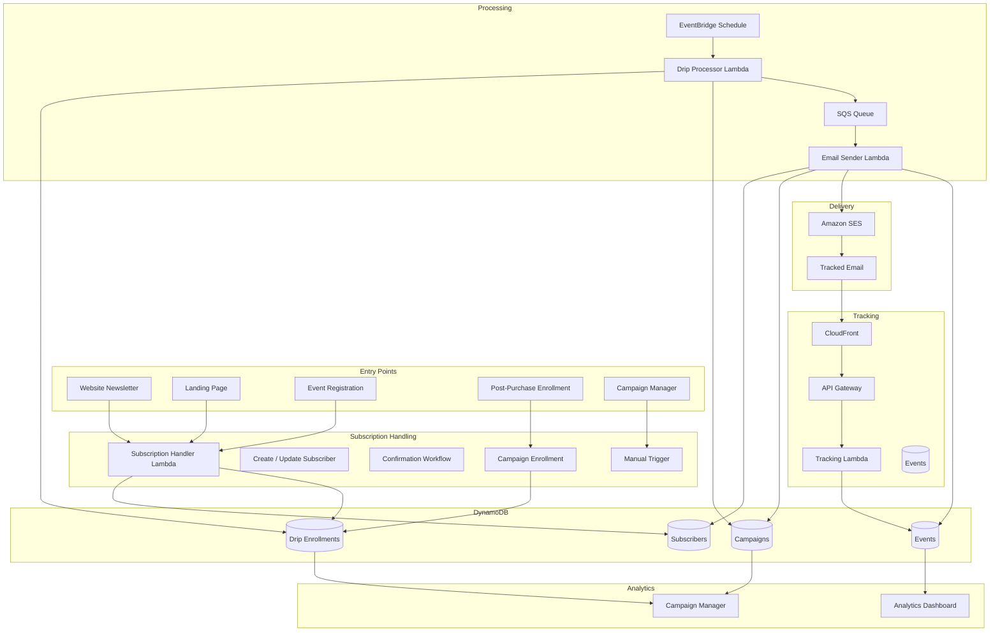

# AWS Email Marketing System — Architecture Case Study

> **Employer-safe architecture summary.** Environment-specific domains, distribution IDs, API identifiers, user IDs, bucket names, and business campaign names have been generalized.

## Architecture Summary

This design uses managed AWS services to separate subscription handling, campaign scheduling, message queuing, delivery, tracking, and analytics.

### Core services

- **AWS Lambda** — subscription, drip-processing, sending, tracking, and API logic
- **Amazon DynamoDB** — subscribers, campaigns, enrollments, and event records
- **Amazon SQS** — decouples scheduling from email sending
- **Amazon EventBridge** — scheduled campaign processing
- **Amazon SES** — email delivery
- **Amazon CloudFront + API Gateway** — tracked open/click request path
- **Static management UI** — campaign and analytics administration

## Processing Model

1. A user subscribes or is enrolled through an approved entry point.
2. Subscriber and enrollment records are written to DynamoDB.
3. EventBridge invokes the drip processor on a schedule.
4. Due messages are placed on SQS.
5. The sender Lambda retrieves campaign/subscriber data, adds tracking, and sends through SES.
6. Open/click requests flow through CloudFront and API Gateway.
7. Tracking events are stored in DynamoDB and surfaced through analytics.

## Engineering Considerations

- asynchronous processing through SQS
- idempotent enrollment and send logic
- least-privilege IAM between functions and data stores
- bounce/complaint handling through SES events
- opt-out and consent enforcement
- retry / DLQ behavior for failed sends
- observability through CloudWatch metrics and structured logs
- separation between campaign content, enrollment state, and event telemetry

## Evidence Boundary

This repository is an architecture case study. It demonstrates system decomposition, AWS service selection, event-driven processing, and operational design. It does not expose live customer data, account identifiers, private infrastructure IDs, or production credentials.
