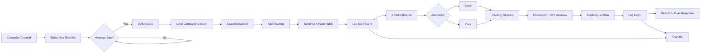

# AWS Email Flow — Creation Through Tracking

> Environment-specific values have been generalized for employer-facing review.

## Flow Stages

### 1. Campaign and enrollment

Campaign definitions are stored separately from subscriber enrollment state. This allows one campaign sequence to serve many subscribers without duplicating content.

### 2. Scheduled evaluation

A scheduled processor evaluates active enrollments and determines whether the next message is due.

### 3. Queueing

Due messages are written to SQS so campaign evaluation and delivery are decoupled.

### 4. Message preparation

The sender resolves subscriber and campaign data, injects open/click tracking references, and sends through SES.

### 5. Delivery telemetry

Sent events are written immediately. Opens and clicks create separate tracking events when the recipient interacts with the message.

### 6. Analytics

Sent/open/click events can be aggregated by campaign, subscriber, or date range.

## Reliability / Operations

- queue-based decoupling prevents the scheduler from blocking on delivery
- failed send attempts should use retries and a DLQ
- subscriber consent and unsubscribe state must be checked before delivery
- delivery, bounce, and complaint metrics should be monitored
- event processing should be idempotent where duplicate invocation is possible
