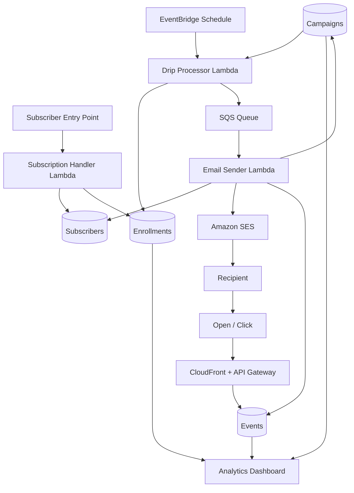

# AWS Email System — Simplified Architecture

## Simple Flow Summary

1. **Subscription** — create or update subscriber and enrollment state.
2. **Scheduling** — EventBridge starts the drip processor.
3. **Queueing** — SQS decouples campaign evaluation from delivery.
4. **Sending** — Lambda prepares content and sends through SES.
5. **Tracking** — CloudFront/API Gateway receive tracking requests and record events.
6. **Analytics** — event and enrollment records drive reporting.

## AWS Services Demonstrated

- AWS Lambda
- Amazon DynamoDB
- Amazon SQS
- Amazon EventBridge
- Amazon SES
- Amazon CloudFront
- Amazon API Gateway

## Portfolio Note

This repository intentionally omits live account IDs, domains, resource IDs, subscriber information, and business-specific campaign identifiers. It is intended to demonstrate architecture and event-driven AWS design rather than expose operational configuration.
